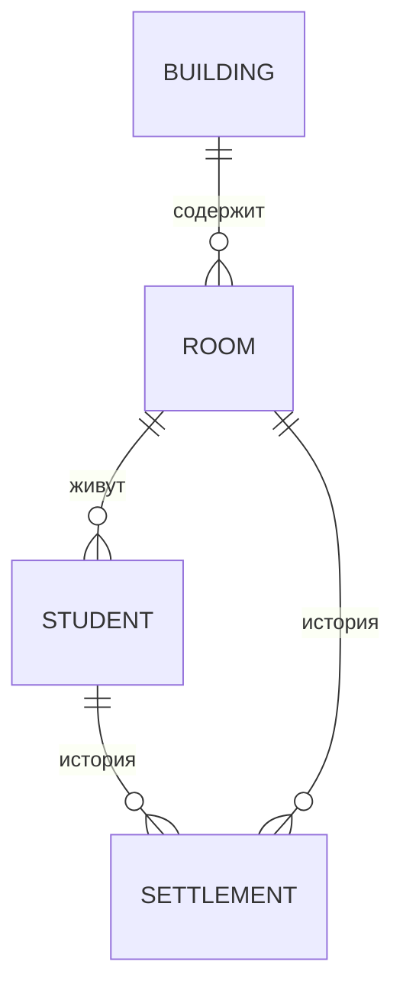
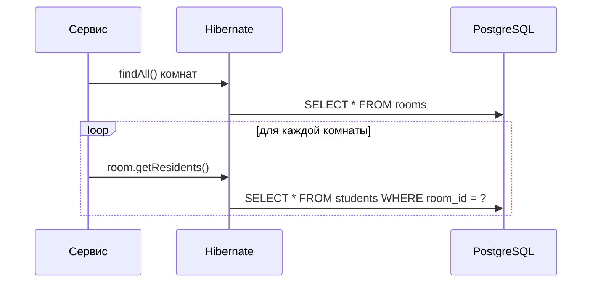

Работа — веб-приложение для учёта заселения студентов в общежитие: студенты, комнаты, корпуса и история заселений хранятся в PostgreSQL, доступ к данным — через Spring Data JPA. Вопросы к защите покрывают ORM и JPA, транзакции, проектирование схемы БД и слоистую архитектуру Spring-приложения.

Учебник опирается на условие работы и на репозиторий `github.com/user/dorm-lab` (коммит `a1b2c3d`): блоки «В твоей работе» цитируют его код. Остальные примеры кода — иллюстрации на той же предметной области, а не решение задания.

## Вопрос 1. Что такое ORM? Как в JPA описываются связи между сущностями?

Приложение думает объектами: у студента есть комната, у комнаты — список жильцов. База данных думает таблицами и внешними ключами. Каждый раз вручную переводить одно в другое — писать `SELECT`, разбирать `ResultSet`, собирать объекты и следить, какие из них изменились, — долго и легко ошибиться. **ORM** (Object-Relational Mapping) берёт этот перевод на себя: по описанию классов он сам строит SQL-запросы, загружает строки в объекты и записывает изменения обратно.

### Сущность и таблица

В JPA класс, который отображается на таблицу, называется **сущностью** и помечается `@Entity`. Поля становятся колонками, поле с `@Id` — первичным ключом.

```java
@Entity
@Table(name = "students")
public class Student {
    @Id
    @GeneratedValue(strategy = GenerationType.IDENTITY)
    private Long id;

    @Column(name = "isu", nullable = false, unique = true)
    private Integer isu;            // номер ИСУ — естественный ключ, но не первичный

    private String fullName;
}
```

### Связи

Связь между сущностями описывается аннотацией над полем-ссылкой. Сторона, в таблице которой лежит внешний ключ, — **владелец связи**: только её изменения попадают в базу.

| Аннотация | Пример в предметной области | Где внешний ключ |
|:--|:-----------|:------|
| `@ManyToOne` | много студентов → одна комната | `students.room_id` |
| `@OneToMany(mappedBy = …)` | у комнаты список жильцов | обратная сторона, своего ключа нет |
| `@ManyToMany` | студенты ↔ кружки | отдельная таблица связи |
| `@OneToOne` | студент ↔ пропуск | у любой из сторон, обычно у зависимой |



*Схема: внешние ключи всегда на стороне «многих» — у студента ссылка на комнату, а не у комнаты список студентов. Поэтому в JPA владелец связи — `@ManyToOne`, а `@OneToMany` только отражает её.*

**Плохо:**

```java
@OneToMany
private List<Student> residents;   // нет mappedBy — JPA создаст лишнюю таблицу room_residents
```

**Хорошо:**

```java
@OneToMany(mappedBy = "room")
private List<Student> residents;   // связь хранится в students.room_id
```

Без `mappedBy` JPA считает `@OneToMany` самостоятельной связью и заводит для неё таблицу-посредник: одна и та же связь хранится дважды, и данные в двух местах рано или поздно разойдутся.

### Ленивая загрузка



*Схема: проблема N+1 — один запрос за списком комнат и по запросу на жильцов каждой из них. На 300 комнатах это 301 запрос вместо одного-двух.*

Связи `@OneToMany` по умолчанию загружаются лениво: жильцы читаются из базы при первом обращении к списку. Это экономит память, но в цикле по комнатам даёт **проблему N+1**. Лечится она загрузкой связи тем же запросом: `JOIN FETCH` в JPQL или `@EntityGraph` на методе репозитория. Подробнее о том, почему ленивая загрузка ломается вне транзакции, — [вопрос 3](#q3).

> [!WARNING]
> **Подводный камень**
>
> `FetchType.EAGER` на `@OneToMany` не решает N+1, а прячет его: Hibernate всё равно выполняет отдельный запрос на каждую коллекцию, только теперь всегда, даже когда жильцы не нужны.

> [!NOTE]
> **В твоей работе**
>
> Файл: `src/main/java/ru/dorm/model/Student.java`, строки 18–31
>
> ```java
> @ManyToOne(fetch = FetchType.LAZY)
> @JoinColumn(name = "room_id")
> private Room room;
> ...
> @OneToMany(mappedBy = "student", cascade = CascadeType.ALL)
> private List<Settlement> settlements;
> ```
>
> Студент — владелец связи с комнатой, ключ `room_id` лежит в `students`, как и требует пункт 2.3 условия («студент проживает не более чем в одной комнате»). `cascade = ALL` на истории заселений означает, что удаление студента удалит и его историю, — на защите стоит быть готовым объяснить, почему это допустимо.

> [!CAUTION]
> **Расхождение с практикой**
>
> Условие требует физически удалять выселенных студентов. Обычно так не делают: история заселений теряется, а отчёты за прошлые периоды перестают сходиться. На защите стоит сказать, что удаление сделано по условию, и назвать альтернативу — флаг `active` или дату выселения.

> [!TIP]
> **Могут спросить**
>
> **Чем `@JoinColumn` отличается от `mappedBy`?** `@JoinColumn` ставится на стороне-владельце и называет колонку внешнего ключа. `mappedBy` ставится на обратной стороне и говорит, что связь уже описана полем другой сущности.
>
> **Можно ли обойтись без ORM?** Да: JDBC или `JdbcTemplate` с ручным SQL. Это проще для отчётов и сложных запросов, но отслеживать изменения объектов и связи придётся самому.
>
> **Что будет, если обратиться к ленивой коллекции после закрытия транзакции?** `LazyInitializationException`: сессии Hibernate уже нет, и загрузить данные нечем.

***

Учебник подготовлен к защите лабораторной работы по её условию и репозиторию; примеры кода иллюстрируют принципы и не являются готовым решением задания.
